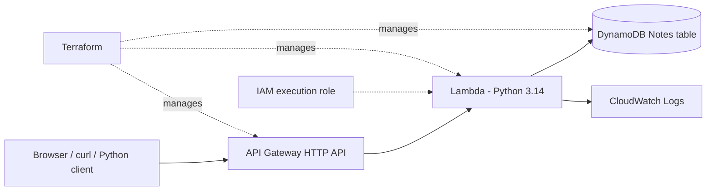

# AWS Serverless Notes API — Terraform Portfolio Project

A lightweight, cloud-native **Python CRUD REST API** deployed with **Terraform**. Built to demonstrate infrastructure as code (IaC), serverless computing, IAM least-privilege permissions, DynamoDB persistence, CloudWatch observability, and GitHub Actions continuous integration.

**Author:** Olufunso Ojo  
**Deployment region:** `eu-west-2` (London)  
**Status:** Source code and Terraform configuration are ready; deployment must be completed in your own AWS account.  
**Important:** This is a public, **unauthenticated demo API**. Do not put personal, confidential, or sensitive data in it.

## Architecture



Unlike EC2-based applications, there is **no virtual server, load balancer or VPC to manage**. API Gateway is the public entry point. Lambda handles requests, and DynamoDB stores the records.

## Features

- Six HTTP routes including a health check and full create/read/update/delete support
- UUID IDs for newly created notes and validation of note content (1–1,000 characters)
- Missing-note handling with HTTP 404 and other appropriate HTTP status codes
- DynamoDB on-demand billing and API Gateway request throttling
- IAM policy limited to CRUD operations on the application table; no `AmazonDynamoDBFullAccess`
- CloudWatch application logs with 7-day retention
- Automated Lambda unit tests, GitHub Actions tests, Terraform formatting and validation
- Easy deployment and destruction using Terraform CLI

## Repository structure

```text
aws-serverless-notes-terraform/
├── .github/workflows/ci.yml    # Tests and Terraform checks
├── lambda/lambda_function.py    # Lambda Python handler
├── tests/test_lambda_function.py
├── scripts/smoke_test.py       # End-to-end checks against AWS
├── screenshots/README.md       # How to capture deployment evidence
├── api_gateway.tf              # API, routes, stage, invoke permissions
├── dynamodb.tf                 # DynamoDB table
├── iam.tf                      # Execution role and table policy
├── lambda.tf                   # Lambda packaging, function, logs
├── outputs.tf                  # URLs and AWS resource names
├── variables.tf                # AWS region, prefix, retention
├── versions.tf                 # Terraform + provider versions
├── requirements-dev.txt
├── pytest.ini
├── .gitignore
└── README.md
```

## 1. Prerequisites (Windows + VS Code)

1. An AWS account with permissions to create IAM, Lambda, API Gateway, DynamoDB and CloudWatch resources.
2. [Terraform CLI](https://developer.hashicorp.com/terraform/install) installed (`terraform -version`).
3. [AWS CLI](https://docs.aws.amazon.com/cli/latest/userguide/getting-started-install.html) installed (`aws --version`).
4. Git installed (`git --version`) and a GitHub account.
5. Python 3.14 for matching Lambda locally; Python 3.13 also works for the included tests.
6. VS Code with the HashiCorp Terraform and Python extensions (optional but recommended).

**Sign in to AWS securely.** Prefer your organisation's IAM Identity Center / `aws configure sso`. For a personal IAM user, `aws configure` can be used, but **never use root access keys** and never commit AWS credentials or secrets. Set the CLI profile explicitly if you use more than one AWS account.

In the VS Code PowerShell terminal, check the intended account and region **before** applying:

```powershell
aws sts get-caller-identity
aws configure get region
```

The Terraform provider defaults to **London (`eu-west-2`)** independently of your AWS CLI default region. Check that it is the correct region for this project.

If you already created a `Notes` table or `notes-service` Lambda by hand, **do not assume Terraform manages them**. This project creates *separately named* resources such as `serverless-notes-api-notes` and `serverless-notes-api-function`. Do not delete your previous resources by accident.

## 2. Deploy with Terraform

Extract the ZIP, open the `aws-serverless-notes-terraform` folder in VS Code and open a PowerShell terminal in that folder. Run these commands one at a time:

```powershell
terraform fmt -recursive
terraform init
terraform validate
terraform plan -out=tfplan
```

**Review the plan**: it must refer to your correct AWS account and intended resources. Terraform can create billable cloud resources. When satisfied, apply:

```powershell
terraform apply tfplan
```

After a successful apply, get the actual API addresses (do not use the sample URL from the original tutorial):

```powershell
terraform output -raw api_base_url
terraform output -raw notes_url
terraform output -raw health_url
```

Terraform provisions the resources **in the AWS account**, so you can view them in the AWS Console by setting the region to **Europe (London)** and opening Lambda, DynamoDB, API Gateway, IAM and CloudWatch.

## 3. Test your deployed API

For the easiest cross-platform end-to-end check:

```powershell
$apiBase = terraform output -raw api_base_url
python scripts/smoke_test.py $apiBase
```

The smoke test creates a temporary sample note, reads it, lists notes, updates it and deletes it. It also checks the health route.

### Manual tests from PowerShell

```powershell
$api = terraform output -raw notes_url

# Create a note
$note = Invoke-RestMethod -Method Post -Uri $api -ContentType 'application/json' -Body '{"content":"My first note"}'
$note

# List notes (up to 25 on each page)
Invoke-RestMethod -Method Get -Uri $api

# Retrieve one note
Invoke-RestMethod -Method Get -Uri "$api/$($note.noteId)"

# Update a note
Invoke-RestMethod -Method Put -Uri "$api/$($note.noteId)" -ContentType 'application/json' -Body '{"content":"Updated note"}'

# Delete the note
Invoke-RestMethod -Method Delete -Uri "$api/$($note.noteId)"
```

### Manual tests with curl (Git Bash / Linux)

```bash
API_URL="$(terraform output -raw notes_url)"
curl -i "$API_URL"
curl -i -X POST "$API_URL" -H 'Content-Type: application/json' -d '{"content":"Hello from curl"}'
# Use the returned noteId for GET/PUT/DELETE:
curl -i "$API_URL/NOTE_ID"
curl -i -X PUT "$API_URL/NOTE_ID" -H 'Content-Type: application/json' -d '{"content":"Edited"}'
curl -i -X DELETE "$API_URL/NOTE_ID"
```

**API routes and expected responses**

| Method | Endpoint | Purpose | Success status |
|---|---|---|---|
| GET | `/health` | Health check | 200 |
| POST | `/notes` | Create a note with a generated UUID | 201 |
| GET | `/notes` | List up to 25 notes + continuation token | 200 |
| GET | `/notes/{noteId}` | Retrieve a single note | 200 or 404 |
| PUT | `/notes/{noteId}` | Update note content | 200 or 404 |
| DELETE | `/notes/{noteId}` | Delete a note | 204 or 404 |

**Request body for create/update:** `{"content": "A short note"}`. The note ID is now in the **URL path** for GET, PUT and DELETE instead of in the JSON body. The GET list response is an object:

```json
{
  "items": [
    {"noteId": "example-uuid", "content": "A short note"}
  ],
  "nextToken": null
}
```

When `nextToken` has a value, get the next page with `GET /notes?nextToken=TOKEN` (URL-encode if needed). This is intentionally a simple demo pagination scheme, not a production-grade opaque cursor.

## 4. Run automated unit tests locally

```powershell
python -m pip install -r requirements-dev.txt
python -m pytest -q
```

Unit tests use fake DynamoDB calls and do **not** access your AWS account. GitHub Actions runs them on every push and pull request. The CI workflow **does not deploy** to AWS, so no AWS keys are stored in GitHub.

## 5. Publish the repository on GitHub

First, create a **new empty public GitHub repository** named `aws-serverless-notes-terraform` (do not initialise the new repository with an additional README, since this folder already has one). In the VS Code terminal, enter:

```powershell
git init
git branch -M main
git add .
git status
git commit -m "Build serverless Notes API with Terraform and GitHub Actions"
git remote add origin https://github.com/YOUR_USERNAME/aws-serverless-notes-terraform.git
git push -u origin main
```

Replace `YOUR_USERNAME` with your GitHub username. You must sign in to GitHub to authorise the push. If `git status` shows `.tfstate`, `*.pem`, AWS credentials, or the Terraform ZIP, **do not commit them**. The included `.gitignore` already excludes common sensitive and generated files.

Tip: After a successful `terraform init`, **commit the generated `.terraform.lock.hcl`** so reviewers get reproducible provider versions. The `.terraform/` directory stays ignored.

Then pin the repo on your GitHub profile and update this README with **real** links or screenshots of your successful deployment. Use the checklist in `screenshots/README.md`.

## 6. Clean up AWS resources when finished

The demo resources can incur charges, even if traffic is small. When you no longer need the live deployment:

```powershell
terraform plan -destroy
terraform destroy
```

Run these **from the same project directory with its original Terraform state**. `terraform destroy` permanently deletes the DynamoDB table and any notes it contains, in addition to the other managed resources. Don't delete your `terraform.tfstate` before destroying resources.

## Important security and production notes

- The demo HTTP API is **public, with no authentication**. Anyone with its URL can read, alter or delete test notes. Use dummy data only. For real users, add Cognito/JWT authentication and enforce per-user ownership of notes.
- API CORS headers are enabled for browser demos; **CORS is not authentication or security**.
- DynamoDB uses on-demand billing. The default infrastructure is small, but **not guaranteed to be free**. Set an AWS Budget and inspect the cost estimate before deployment.
- The Lambda package deliberately uses the **AWS-managed runtime's Boto3 SDK** to keep this educational project simple. For production, package and pin Boto3 plus compatible dependencies as AWS recommends.
- Terraform's local state should be protected and never pushed to GitHub. For team use, move state to a secured remote S3 backend with versioning and state locking, and restrict access.
- CloudWatch stores request metadata and errors, not note content. CloudWatch retention is 7 days by default.
- A public portfolio can display the repository and architecture without leaving a billable demo permanently running.

## Employer-facing talking points

> I designed and automated a serverless REST API using Terraform and AWS Lambda, API Gateway, DynamoDB, IAM and CloudWatch. I implemented Python CRUD endpoints with validation and error handling, scoped DynamoDB permissions to a single table, wrote automated tests and built a GitHub Actions CI pipeline. The solution demonstrates reproducible cloud infrastructure, API integration, troubleshooting and operational observability.

**Skills demonstrated:** AWS, Terraform, Infrastructure as Code, Python, REST APIs, serverless, IAM, DynamoDB, API Gateway, CloudWatch, Git, GitHub Actions, unit testing, CI, resource lifecycle management.

MIT License. See [LICENSE](LICENSE).
