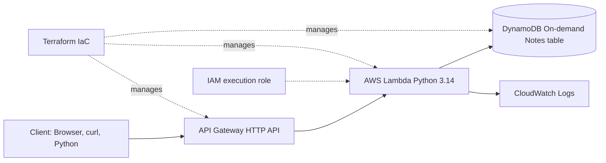

# Architecture and design decisions

- **Compute**: Lambda executes only when invoked; no EC2 instances or VPC required.
- **Networking**: API Gateway HTTP API exposes public HTTP routes; `$default` stage eliminates a stage suffix.
- **Persistence**: DynamoDB `PAY_PER_REQUEST`, partition key `noteId` (string). Scanning is capped at 25 items per response and supports continuation tokens.
- **Permissions**: Lambda can access only the specified table for GetItem, PutItem, UpdateItem, DeleteItem and Scan. CloudWatch logging uses AWSLambdaBasicExecutionRole.
- **Observability**: Application and exception logs go to `/aws/lambda/<function-name>` with configurable 7-day retention.
- **Safety**: This example is public and unauthenticated. Do not store real personal or sensitive data. For production, add JWT/Cognito authorisation, stronger protections and monitoring.
- **Delivery**: GitHub Actions runs unit tests and `terraform validate`, but deliberately has no AWS deployment credentials.
- **Cost**: Consumption-based AWS services can still incur charges from traffic and logging. Review AWS Pricing and budgets.
